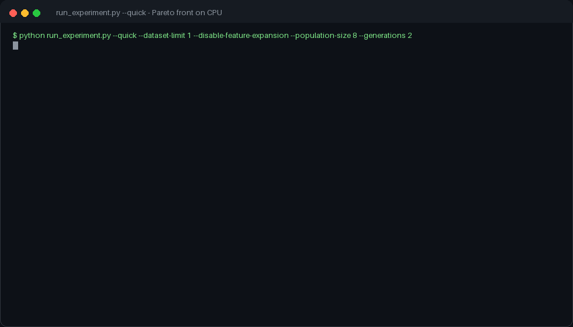

# Multi-Objective Feature Selection
### NSGA-II for Medical Tabular Data

<p align="left">
  
  
  
  
  <a href="https://github.com/royxforge/multi-objective-feature-selection/actions/workflows/ci.yml"></a>
  
</p>

> **NSGA-II applied to feature selection on medical tabular data, optimising accuracy and feature count at the same time instead of collapsing them into one score.** You get the whole Pareto front back, so a deployment constraint can pick a point rather than a hyperparameter choosing for you. Every baseline it is compared against is committed with the results.
>
> **Result:** **4 features out of 30** — an 87% reduction — at **96.49%** test accuracy, above the best full-feature RandomForest baseline (**94.74%** on all 30). The whole front is committed: 3 features still reach 95.38% cross-validated accuracy, and 6 features peak at 97.14%.
>
> **Try it on CPU:** `python run_experiment.py --quick --dataset-limit 1 --disable-feature-expansion --population-size 8 --generations 2`




---

## Table of Contents

- [The Problem](#the-problem)
- [Key Result](#key-result)
- [Why Multi-Objective](#why-multi-objective)
- [Algorithm: NSGA-II](#algorithm-nsga-ii)
- [Experimental Setup](#experimental-setup)
- [Results](#results)
- [Baseline Comparison](#baseline-comparison)
- [Repository Structure](#repository-structure)
- [Installation](#installation)
- [Usage](#usage)
- [Research Context](#research-context)
- [Citation](#citation)

---

## The Problem

In medical ML, feature selection is not a single-objective problem. Fewer features means lower data collection cost, reduced patient burden, more interpretable models, and lower overfitting risk. More features means higher potential accuracy. The optimal trade-off is dataset-dependent and cannot be determined by a single scalar metric.

Standard approaches (RFE, importance-based selection, PCA) collapse this trade-off into a single number and return one solution. They do not tell you what accuracy you give up by removing two more features, or what you gain by adding three.

**NSGA-II surfaces the entire trade-off curve. Practitioners choose any point on the Pareto front based on their deployment constraints.**

---

## Key Result

> **4 features out of 30 (87% reduction) at 96.49% test accuracy**, beating the best full-feature baseline (Grid Search RandomForest, 30 features, 94.74%) while discarding 26 features. The 3-feature point still reaches 95.38% cross-validated accuracy, and 6 features peak at 97.14%.

---

## Why Multi-Objective

Single-objective feature selection methods used as baselines:

| Method | Test Accuracy | Features Used | Trade-off Visible |
|---|---|---|---|
| Grid Search RF | 94.74% | 30 | No |
| RF Importance + RF | 94.74% | 22 | No |
| RFE + RandomForest | 94.74% | 30 | No |
| PCA + RandomForest | 92.98% | 5 components | No |
| Random Search RF | 94.74% | 30 | No |
| **NSGA-II (this work)** | **96.49%** | **4** | **Yes - full Pareto front** |

Every single-objective baseline returns one solution and leaves the trade-off invisible. NSGA-II returns the full front - every Pareto-optimal (accuracy, feature count) pair discovered during evolution - so the 3-feature and 6-feature points are available from the same run.

---

## Algorithm: NSGA-II

Non-dominated Sorting Genetic Algorithm II maintains a population of candidate (feature subset, classifier hyperparameter) pairs and evolves them across generations toward the Pareto front using four mechanisms:

**Non-dominated sorting** ranks solutions by Pareto dominance. A solution A dominates B if A is no worse than B on all objectives and strictly better on at least one. Solutions are sorted into fronts: Front 1 contains all non-dominated solutions, Front 2 contains solutions dominated only by Front 1, and so on.

**Crowding distance** preserves diversity along each front by measuring how isolated a solution is from its neighbors in objective space. Solutions in sparse regions are preferred during selection, preventing the population from collapsing to a single point on the front.

**Tournament selection** selects parents for the next generation. Candidates are compared first by front rank, then by crowding distance.

**Elitism** combines parents and offspring into a pool of size 2N, then selects the top N by rank and crowding distance. Best solutions are never lost.

```
Initialize population of (feature mask, RF hyperparameters)
Population size: 32, Generations: 10 (CLI defaults: 64 / 30)
         |
         v
+---------------------+
|  Evaluate           |   CV training accuracy + feature count
|  (two objectives)   |   RandomForest with evolved hyperparameters
+----------+----------+
           |
           v
+---------------------+
|  Non-dominated Sort |   Assign Pareto front rank to each individual
|  + Crowding Distance|   Measure isolation within each front
+----------+----------+
           |
           v
+---------------------+
|  Tournament Select  |   Rank first, crowding distance as tiebreaker
|  Crossover + Mutate |   Uniform mask crossover (p=0.9)
|                     |   Bit-flip mutation (p=0.02 per feature)
|                     |   Blend crossover on hyperparams (alpha=0.3)
|                     |   Gaussian hyperparameter mutation (sigma=0.1)
+----------+----------+
           |
     Next Generation
           |
     (10 generations)
           |
           v
    Pareto Front of (feature subset, classifier) pairs
```

### Evolved Hyperparameters

NSGA-II jointly evolves feature masks and RandomForest hyperparameters:

| Hyperparameter | Search Range |
|---|---|
| n_estimators | 60 - 400 |
| max_depth | 2 - 24 |
| min_samples_split | 2 - 20 |
| min_samples_leaf | 1 - 10 |
| max_features | 0.15 - 1.0 (fraction) |

The framework also supports SVM (RBF/linear, C and gamma evolved in log space) and optionally XGBoost. The Pareto-optimal solution in this run converged on RandomForest.

---

## Experimental Setup

**Dataset:** Wisconsin Breast Cancer (scikit-learn built-in, UCI origin)

| Property | Value |
|---|---|
| Samples | 569 |
| Features | 30 (continuous) |
| Task | Binary classification: malignant vs. benign |
| Class balance | Balanced weighting (class_weight="balanced") |

**NSGA-II Configuration:**

| Parameter | Value |
|---|---|
| Population size | 32 |
| Generations | 10 |
| Crossover probability | 0.9 |
| Mutation probability (individual) | 0.3 |
| Bit-flip probability (per feature) | 0.02 |
| Hyperparameter mutation | Gaussian perturbation, sigma=0.1 |
| Crossover type | Uniform (feature mask) + Blend alpha=0.3 (hyperparameters) |
| Selection | NSGA-II via DEAP selNSGA2 |

The committed run uses 32 individuals over 10 generations with 5-fold CV; the CLI defaults (64 / 30) take considerably longer on CPU. Raise them with `--population-size` / `--generations`.

---

## Results

### Pareto-Optimal Solutions

The front keeps improving accuracy while the feature count falls, so the reduction is not bought with accuracy:

| Features | CV Accuracy (evolution) | Feature Reduction |
|---|---|---|
| 3 / 30 | 95.38% | 90% |
| **4 / 30 (selected)** | **96.92%** | **87%** |
| 6 / 30 | 97.14% | 80% |

The selected 4-feature solution scores **96.49% on the held-out test set** - F1 0.972, precision 0.986, recall 0.958 - against 96.92% CV accuracy during evolution. Only the selected solution is evaluated on the test split; the other front points are ranked by CV accuracy.

**Evolved classifier configurations on the front:**
- 4 features (`[1, 18, 23, 24]`): RandomForestClassifier, n_estimators 131, max_depth 5, min_samples_split 7, min_samples_leaf 3, max_features 0.58
- 6 features (`[1, 21, 22, 23, 24, 27]`): RandomForestClassifier, n_estimators 278, max_depth 10, min_samples_split 7, min_samples_leaf 1, max_features 0.31

### What the Pareto Front Shows

The front maps every discovered (feature count, accuracy) trade-off point from the minimal viable subset to the full feature set. A practitioner deploying to a resource-constrained environment can choose a point further left on the front. A practitioner where accuracy is critical can choose a point further right. Both choices are informed by the same optimization run.

---

## Baseline Comparison

| Method | Test Accuracy | Features | Notes |
|---|---|---|---|
| Grid Search RF | 94.74% | 30 | Exhaustive hyperparameter search, all features |
| RF Importance + RF | 94.74% | 22 | Importance-ranked, no trade-off |
| RFE + RandomForest | 94.74% | 30 | Single solution, no trade-off curve |
| PCA + RandomForest | 92.98% | 5 components | Components, not original features - loses interpretability |
| Random Search RF | 94.74% | 30 | Suboptimal hyperparameters |
| **NSGA-II (this work)** | **96.49%** | **4** | **Full Pareto front, joint feature + hyperparameter optimization** |

NSGA-II beats every baseline on accuracy while using 4 features instead of 30, and returns a complete trade-off curve rather than one point.

Paired across 15 folds, the improvement is significant against Random Search RF after Holm correction (adjusted p = 0.027); against Grid Search, RFE, RF Importance and PCA the margin is positive but does not survive correction (adjusted p = 0.17-0.23). One 569-sample dataset does not support a stronger claim than that.

---

## Repository Structure

```
multi-objective-feature-selection/
|
+-- run_experiment.py   # Main NSGA-II implementation + experiment runner
+-- requirements.txt
+-- LICENSE
+-- README.md
```

---

## Installation

```bash
git clone https://github.com/royxforge/multi-objective-feature-selection.git
cd multi-objective-feature-selection

pip install -r requirements.txt
```

**Core dependencies:** scikit-learn · DEAP · NumPy · Matplotlib

---

## Usage

```bash
# All three bundled medical datasets
python run_experiment.py

# Pick which datasets to run (keys, display names or aliases)
python run_experiment.py --datasets "Pima Indians Diabetes,Heart Disease"
python run_experiment.py --datasets pima,heart

# See what is available, or keep the first N datasets
python run_experiment.py --list-datasets
python run_experiment.py --limit 1
```

```console
$ python run_experiment.py --list-datasets
wisconsin    Wisconsin Breast Cancer
pima         Pima Indians Diabetes
heart        Heart Disease (Cleveland)
```

Each run loads the selected datasets, runs NSGA-II for the configured number of generations across the configured population (defaults: 30 generations, population 64), evaluates all Pareto-optimal solutions on the held-out test set, and plots the Pareto front in objective space (accuracy vs. feature count).

| Flag | Effect |
|------|--------|
| `--datasets "A,B"` | Run only the named datasets (keys, display names or aliases; case-insensitive; duplicates collapse) |
| `--list-datasets` | Print the available dataset keys and exit |
| `--limit N` | Keep only the first `N` datasets (useful for smoke tests) |

To add another dataset, extend `src/moefs/datasets.py` with a loader and register
it; the optimizer is dataset-agnostic and works with any binary classification
dataset in sklearn-compatible format (X, y arrays).

---

## Research Context

Multi-objective feature selection is an active research area in medical ML, where interpretability requirements structurally conflict with accuracy maximization. Regulatory frameworks (EU AI Act, FDA guidance on clinical decision support) increasingly require explainability, which directly rewards feature economy.

NSGA-II (Deb et al., 2002) is one of the most cited multi-objective evolutionary algorithms, with strong theoretical guarantees on Pareto front convergence and diversity preservation via crowding distance. This implementation extends the standard NSGA-II formulation by jointly evolving feature masks and classifier hyperparameters in a single optimization loop - avoiding the two-stage bias introduced by selecting features first and tuning hyperparameters second.

**Connection to related work:** The unsupervised confidence metric in [Unsupervised Confidence Estimation
](https://github.com/royxforge/unsupervised-confidence-estimation) and the drift monitoring in [Production Drift Detection
](https://github.com/royxforge/production-drift-detection) both operate on model outputs. Feature selection determines what goes into the model. These three projects form a coherent pipeline: select features carefully, monitor for drift, and quantify uncertainty in deployment. [Unified Time Series Foundation Model](https://github.com/royxforge/uniftsm) extends the same philosophy to time series foundation models, where the 15 meta-features used for model selection are a forecasting-specific analog of the feature economy question studied here.

---

## Citation

```bibtex
@software{roy2025nsga2featureselection,
  author = {Roy, Sourav},
  title  = {multi-objective-feature-selection: NSGA-II for Medical Tabular Data},
  year   = {2026},
  url    = {https://github.com/royxforge/multi-objective-feature-selection}
}
```

---

<p align="center">
  <sub>Built by <a href="https://github.com/royxforge">Sourav Roy</a> · Artificial Intelligence Engineer · Accure Inc.</sub>
</p>
